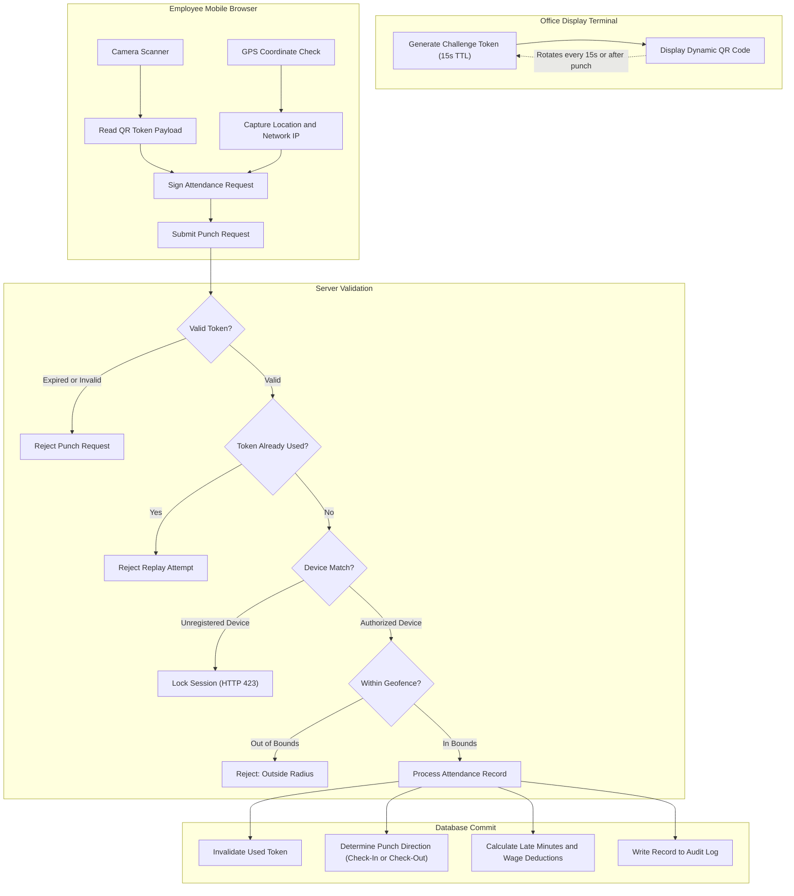
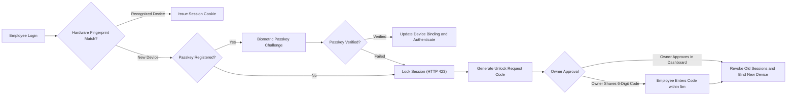
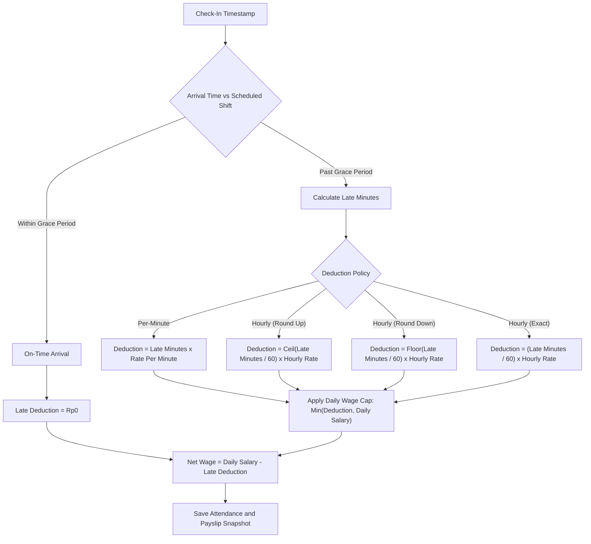

# Payroll & QR Attendance System

A web application for daily employee attendance tracking and automated wage calculation. The system uses rotating QR codes displayed on office terminals, GPS radius checks on mobile punch-in, single-device binding, and configurable late deduction policies.

---

## Architecture & Workflows

### 1. QR Attendance Verification



---

### 2. Device Binding and Replacement



---

### 3. Daily Wage Calculation and Late Deductions



---

## Features

### 1. Integer IDR Wage Engine
- Wages are stored and calculated as integer Indonesian Rupiah (IDR) values per completed shift (e.g., Rp150.000 / day).
- Calculations avoid floating-point math to prevent decimal rounding differences.
- Salary rate adjustments are recorded with effective dates and author identity.

### 2. Rotating QR Terminal
- The office display generates a QR challenge token that rotates every 15 seconds.
- Tokens are invalidated immediately upon a successful scan to prevent photo sharing or proxy attendance.
- The terminal checks token status every 1.5 seconds and refreshes immediately when a token is consumed.
- The system determines automatically whether the scan is a check-in or check-out based on the employee's active shift status.

### 3. Device Binding & Passkey Recovery
- Each employee account is bound to a single physical device profile upon first sign-in.
- Access attempts from unrecognized hardware result in an account lock with an unlock request ID.
- Employees with registered WebAuthn passkeys can self-authenticate after clearing browser storage.
- Owners can unlock accounts directly from the management dashboard or generate a 5-minute single-use 6-digit code.
- Approving a new device revokes existing sessions on previous hardware.

### 4. Geolocation and Office Network Verification
- Verifies employee GPS coordinates against the configured office location and maximum allowable radius.
- Rejects coarse cellular tower estimates (over 80 meters) until stable satellite coordinates are obtained.
- Supports office Wi-Fi public IP verification for indoor environments where satellite signals are weak.

### 5. Multi-Shift and Overnight Support
- Supports morning shifts, evening shifts, and overnight shifts that cross midnight (e.g., 22:00 to 06:00).
- Overnight shifts are linked to their scheduled start date, preventing next-day check-outs from creating duplicate attendance records.

### 6. Activity and Audit Log
- System actions (clock-ins, corrections, device unlock approvals, salary changes, and period closures) are written to an append-only audit log table.
- Log entries are chained with SHA-256 hashes for data integrity.

---

## Technology Stack

| Component | Technology |
| :--- | :--- |
| Application Framework | Next.js 14 (App Router, Server Actions, Route Handlers) |
| Language | TypeScript (Strict Mode) |
| Styling | Tailwind CSS |
| Database ORM | Prisma ORM 5 |
| Database | PostgreSQL (Supabase Pooler) with SQLite local development support |
| Authentication | Device Fingerprint, FIDO2 / WebAuthn Passkeys |
| Cryptography | SHA-256 Digesting, Ed25519 Signatures |
| QR Code Generation | qrcode (Canvas / Data URL) |
| QR Code Decoding | jsQR |
| Data Visualization | Recharts |
| Icons | Lucide React |

---

## Project Structure

```
.
|-- prisma/
|   |-- schema.prisma             # Data models and database relations
|   `-- seed.ts                   # Development seed data and default shifts
|-- src/
|   |-- app/
|   |   |-- layout.tsx            # Root layout and theme providers
|   |   |-- globals.css           # Global styles and design tokens
|   |   |-- login/                # Authentication page (Owner / Employee)
|   |   |-- owner/                # Management console
|   |   |   |-- page.tsx          # Real-time attendance summary
|   |   |   |-- attendance/       # Attendance logs and manual corrections
|   |   |   |-- audit-logs/       # System activity trail
|   |   |   |-- devices/          # Device authorizations and unlock requests
|   |   |   |-- employees/        # Employee directory and wage settings
|   |   |   |-- payroll/          # Wage reports and payslip generation
|   |   |   |-- qr/               # Office QR terminal display
|   |   |   |-- settings/         # Geofence coordinates and office network IP
|   |   |   `-- shifts/           # Shift schedules and deduction policies
|   |   |-- employee/             # Employee portal
|   |   |   |-- page.tsx          # Current shift status and payslip summary
|   |   |   |-- scan/             # QR scanner with camera and GPS check
|   |   |   `-- history/          # Attendance history and wage breakdowns
|   |   `-- api/                  # API route handlers
|   |       |-- auth/             # Login, session, and WebAuthn endpoints
|   |       |-- employee/         # Mobile attendance verification
|   |       |-- geo/              # Geolocation and IP validation
|   |       |-- owner/            # Management and analytics endpoints
|   |       `-- qr/               # QR challenge generation and validation
|   `-- lib/
|       |-- audit.ts              # Append-only activity logger
|       |-- auth.ts               # Session verification and role guards
|       |-- db.ts                 # Prisma client instance
|       |-- device-client.ts      # Device fingerprinting and Web Crypto helpers
|       |-- payroll.ts            # Wage and lateness deduction calculations
|       |-- qr.ts                 # QR token generator and validator
|       |-- rp-resolver.ts        # WebAuthn Relying Party resolver
|       |-- timezone.ts           # Asia/Jakarta time and overnight shift helpers
|       `-- utils.ts              # Deterministic IDR currency formatting
|-- scripts/
|   |-- test-runner.js            # General functional test suite
|   |-- test-token-ttl.js         # QR token expiration tests
|   |-- audit-enterprise-verification.js # Session, device, and payroll tests
|   |-- qa-security-suite.js      # Concurrency and role permission tests
|   |-- test-hardened-architecture.ts    # WebAuthn and device recovery tests
|   |-- test-anti-cheat-geofence.ts      # Geofencing validation tests
|   `-- test-analytics-aggregation.ts    # Attendance KPI and trend tests
`-- README.md
```

---

## Getting Started

### Prerequisites
- Node.js 20.x or higher
- npm 10.x or higher

### Installation

1. Clone the repository:
   ```bash
   git clone https://github.com/aditya0w0/payroll-attendance.git
   cd payroll-attendance
   ```

2. Install dependencies:
   ```bash
   npm install
   ```

3. Configure environment variables in `.env`:
   ```env
   DATABASE_URL="file:./dev.db"
   JWT_SECRET="your-session-secret"
   CRON_SECRET="your-scheduled-job-token"
   AUDIT_SIGNING_PRIVATE_KEY="your-ed25519-private-key"
   AUDIT_SIGNING_PUBLIC_KEY="your-ed25519-public-key"
   ```

4. Initialize the database and load seed data:
   ```bash
   npx prisma db push
   npx prisma db seed
   ```

5. Start the development server:
   ```bash
   npm run dev
   ```
   Open [http://localhost:3000](http://localhost:3000) in your browser.

---

## Default Accounts (Seed Data)

| Role | Identifier | Password | Shift / Rate |
| :--- | :--- | :--- | :--- |
| Owner | `owner@company.com` | `admin123` | Administrator |
| Employee (Budi Santoso) | `budi@company.com` | `employee123` | Shift Pagi (Rp150.000 / day) |
| Employee (Siti Rahma) | `siti@company.com` | `employee123` | Shift Malam (Rp175.000 / day) |
| Employee (Ahmad Fauzi) | `ahmad@company.com` | `employee123` | Shift Sore (Rp140.000 / day) |

---

## Automated Tests

The repository includes automated test scripts verifying wage calculation, token rotation, geofencing, and shift handling.

Run all tests:
```bash
npm run test:all
```

Key test scripts:
- `scripts/test-runner.js`: Wage calculation rules and historical rates.
- `scripts/test-token-ttl.js`: 15-second token expiration and single-use burn verification.
- `scripts/test-anti-cheat-geofence.ts`: Geographic distance checks and coordinate validation.
- `scripts/qa-security-suite.js`: Concurrent attendance punches and role guards.
- `scripts/test-hardened-architecture.ts`: Device binding and passkey recovery.
- `scripts/test-analytics-aggregation.ts`: Daily attendance trends and aggregation calculations.

---

## Production Build

```bash
# Build production bundle
npm run build

# Start production server
npm start
```

---

## License

This project is licensed under the MIT License.
