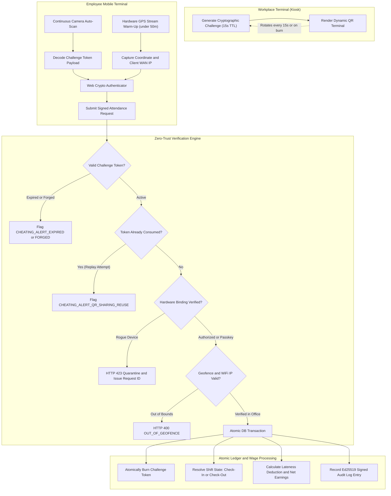
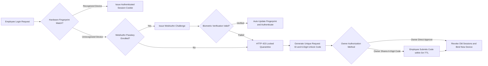
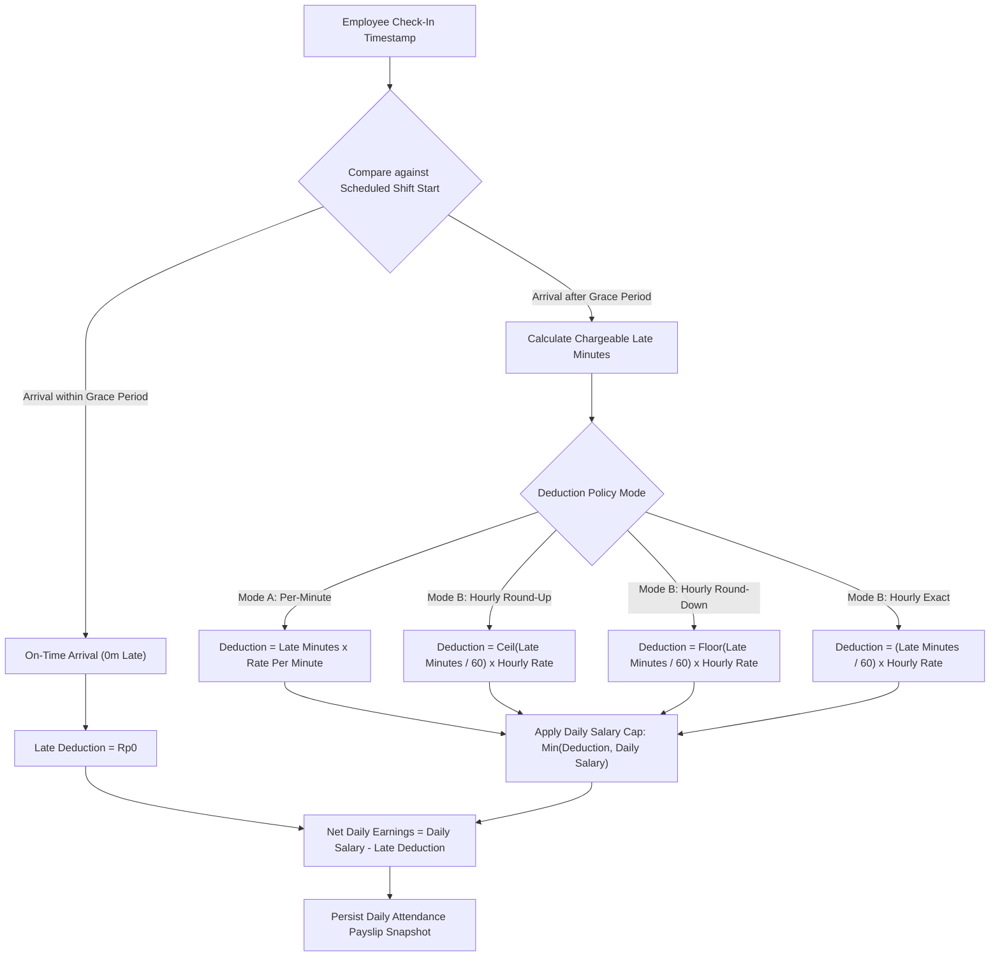

# CyberGuard - Zero-Trust Payroll and Dynamic Cryptographic Attendance System

CyberGuard is an enterprise-grade attendance and daily wage management platform engineered with zero-trust security architecture, single-device biometric passkey binding, dynamic single-use QR challenges, multi-factor geofencing, and an immutable cryptographic audit ledger.

The user interface is crafted using Apple Liquid Glass design specifications: translucent frosted materials, specular meniscus highlights, and fluid responsive interactions.

---

## Architectural Workflows

### 1. Dynamic QR Attendance and Security Verification Pipeline



---

### 2. Single-Device Binding and Zero-Lockout Quarantine Flow



---

### 3. Daily Wage Calculation and Lateness Deduction Engine



---

## Core Security Pillars and Functional Specifications

### 1. Primary Wage Engine: Integer IDR Daily Salary
- Wages are configured as integer Indonesian Rupiah (IDR) values per completed shift (e.g., Rp150,000 / day).
- Floating-point calculations are strictly avoided to eliminate fractional rounding discrepancies in financial statements.
- Any wage modification records an immutable snapshot preserving prior compensation rates, effective dates, and authorizing owner identity in `EmployeeSalaryHistory`.

### 2. Dynamic Workplace QR Terminal
- The office terminal displays a server-generated QR challenge token that rotates every 15 seconds (`expiresAt = now + 15s`).
- **Atomic Token Burn**: Challenge tokens are consumed and burned immediately upon successful scan, preventing proxy attendance via screen photography or messaging apps.
- **Fast Queue Polling**: The workplace terminal polls active token status every 1500ms to immediately render a fresh challenge whenever a preceding employee burns a token.
- **Contextual State Transition**: The server automatically resolves whether an employee is checking in (`Absen Masuk`) or checking out (`Absen Pulang`).

### 3. FIDO2 / WebAuthn Biometric Passkey and Hardware Binding
- Employee terminals are bound to a single physical device profile on first login.
- Access attempts from unrecognized hardware triggers `HTTP 423 Locked` quarantine with a tracked Request ID (e.g., `REQ-94218`).
- **Zero-Lockout Recovery**: Employees with registered WebAuthn / Passkey credentials can self-recover from browser storage clears without administrator intervention.
- **Owner Unlock Workflow**: Owners can verify the employee and either click Direct Approve or share a cryptographically randomized 6-digit One-Time Unlock Code valid for 5 minutes.
- **Session Revocation**: Approving a replacement device automatically purges all active session tokens on older hardware.

### 4. Multi-Factor Geolocation and WiFi Verification
- **GPS Stream Warm-Up Engine**: Uses real-time geographic stream polling (`watchPosition`) to discard inaccurate cellular BTS estimates (accuracy over 80m) until true satellite lock (under 50m) is established.
- **Haversine Geofence Enforcement**: Validates geographic distance between employee check-in coordinates and registered workplace coordinates.
- **Indoor WiFi Public IP Balancing**: Supports office WiFi WAN IP matching to balance indoor structural interference where GPS signals attenuate.

### 5. Flexible Shifts and Overnight Attendance Logic
- Accommodates Morning (08:00 - 17:00), Evening (16:00 - 00:00), and Overnight Shifts (22:00 - 06:00 next day).
- Overnight shifts are deterministically bound to a single shift calendar date instance, ensuring check-outs occurring on calendar day D+1 are never registered as distinct attendance records.

### 6. Zero-Trust Cryptographic Audit Ledger
- System actions (creations, policy changes, scans, device quarantines, unlock approvals, and payroll closures) are committed to an append-only `AuditLog` table.
- Entries are sealed with SHA-256 hash chains and Ed25519 asymmetric digital signatures to guarantee tamper evidence.
- Security incidents such as expired tokens, replay attempts, and forged challenges trigger immediate high-priority alerts on the Owner console.

### 7. Apple Liquid Glass Design System
- Built to mirror native macOS Sonoma and Sequoia glass materials:
  - `.liquid-glass`: Translucent glass with dual specular meniscus rim highlights, 28px backdrop blur, and 210% saturation boost.
  - `.liquid-glass-dock` and `.liquid-glass-pill`: Capsule containers with light refractions.
  - `.liquid-glass-obsidian`: High-tier smoked crystal material for primary financial ledgers.
- High-contrast visual hierarchy that remains legible under direct sunlight and low-light environments.

---

## Technology Stack

| Category | Technology |
| :--- | :--- |
| Application Framework | Next.js 14 (App Router, Server Actions, Route Handlers) |
| Programming Language | TypeScript 5 (Strict Mode) |
| Styling and Materials | Tailwind CSS, Apple Liquid Glass Design Tokens |
| Database ORM | Prisma ORM 5 |
| Relational Database | PostgreSQL (Supabase Pooler) with SQLite Development Fallback |
| Authentication | Single-Device Web Crypto API, FIDO2 / WebAuthn Passkeys |
| Cryptography | SHA-256 Digesting, Ed25519 Asymmetric Signatures |
| QR Code Generation | qrcode (Canvas / DataURL Server Generation) |
| Barcode Decoding | @zxing/browser, @zxing/library |
| Analytics Visualization | Recharts Responsive Charts |
| Iconography | Lucide React |

---

## Project Structure

```
.
|-- prisma/
|   |-- schema.prisma             # Relational data models and indexes
|   `-- seed.ts                   # Enterprise seed fixtures and policies
|-- src/
|   |-- app/
|   |   |-- layout.tsx            # Root application layout and ambient aurora canvas
|   |   |-- globals.css           # Apple Liquid Glass CSS specifications and tokens
|   |   |-- login/                # Biometric passkey and single-device login portal
|   |   |-- owner/                # Owner management console
|   |   |   |-- page.tsx          # Real-time metrics and live punch feed
|   |   |   |-- attendance/       # Absence roster and raw attendance logs
|   |   |   |-- audit-logs/       # Immutable zero-trust cryptographic audit trail
|   |   |   |-- devices/          # Hardware authorizations and quarantine requests
|   |   |   |-- employees/        # Employee directory and wage adjustments
|   |   |   |-- payroll/          # Financial statements and period finalization
|   |   |   |-- qr/               # Dynamic workplace QR terminal kiosk
|   |   |   |-- settings/         # GPS geofencing and office WiFi IP configuration
|   |   |   `-- shifts/           # Shift schedules and lateness deduction policies
|   |   |-- employee/             # Mobile-first employee portal
|   |   |   |-- page.tsx          # Active shift overview and daily earnings ledger
|   |   |   |-- scan/             # Continuous auto-scan camera terminal
|   |   |   `-- history/          # Historical attendance logs and wage breakdowns
|   |   `-- api/                  # Secure RESTful API endpoints
|   |       |-- auth/             # Session management and WebAuthn handlers
|   |       |-- employee/         # Mobile terminal attendance verification
|   |       |-- geo/              # Coordinates, geocoding, and IP resolvers
|   |       |-- owner/            # Administrative management and analytics APIs
|   |       `-- qr/               # Dynamic challenge rotation and consumption
|   `-- lib/
|       |-- audit.ts              # Zero-Trust append-only audit logger
|       |-- auth.ts               # Session token verification and role guards
|       |-- db.ts                 # Prisma ORM singleton instance
|       |-- device-client.ts      # Web Crypto keypair and hardware fingerprinting
|       |-- payroll.ts            # Daily salary and lateness deduction math engine
|       |-- qr.ts                 # Cryptographic token generator and validator
|       |-- rp-resolver.ts        # Dynamic WebAuthn Relying Party resolver
|       |-- timezone.ts           # Authoritative Asia/Jakarta time and overnight logic
|       `-- utils.ts              # Indonesian Rupiah currency formatting
|-- scripts/
|   |-- test-runner.js            # Automated acceptance test suite
|   |-- test-token-ttl.js         # Token TTL and anti-cheating verification
|   |-- audit-enterprise-verification.js # Enterprise audit verification suite
|   |-- qa-security-suite.js      # Concurrency and security regression suite
|   |-- test-hardened-architecture.ts    # WebAuthn and storage loss recovery tests
|   |-- test-anti-cheat-geofence.ts      # Geofencing and WiFi IP enforcement tests
|   `-- test-analytics-aggregation.ts    # Attendance trends and absence math tests
`-- README.md
```

---

## Getting Started

### Prerequisites
- Node.js 20.x or higher
- npm 10.x or higher

### Installation

1. Clone the repository:
   ```bash
   git clone https://github.com/aditya0w0/payroll-attendance.git
   cd payroll-attendance
   ```

2. Install dependencies:
   ```bash
   npm install
   ```

3. Configure environment variables in `.env`:
   ```env
   DATABASE_URL="file:./dev.db"
   JWT_SECRET="your-256-bit-session-secret"
   CRON_SECRET="your-scheduled-job-token"
   AUDIT_SIGNING_PRIVATE_KEY="your-ed25519-private-key"
   AUDIT_SIGNING_PUBLIC_KEY="your-ed25519-public-key"
   ```

4. Initialize database schema and seed data:
   ```bash
   npx prisma db push
   npx prisma db seed
   ```

5. Start the development server:
   ```bash
   npm run dev
   ```
   Open [http://localhost:3000](http://localhost:3000) in your browser.

---

## Default Demonstration Credentials

| Role | Identifier | Password | Device Profile |
| :--- | :--- | :--- | :--- |
| Owner / Administrator | `owner@company.com` | `admin123` | Multi-terminal administrative authority |
| Employee (Budi Santoso) | `budi@company.com` | `employee123` | Bound to Authorized MacBook Pro (Rp150,000 / day) |
| Employee (Siti Rahma) | `siti@company.com` | `employee123` | Unbound (auto-binds upon initial login, Rp175,000 / day) |
| Employee (Ahmad Fauzi) | `ahmad@company.com` | `employee123` | Bound to Pixel 8 Terminal (Rp140,000 / day) |

---

## Automated Acceptance and Security Verification

The platform includes 13 automated test suites verifying zero-trust guarantees, anti-cheating boundaries, concurrency safety, and wage calculation accuracy.

Execute all test suites with a single command:
```bash
npm run test:all
```

### Test Suite Coverage

1. `test-runner.js`: Acceptance criteria, salary modifications, and historical immutability.
2. `test-token-ttl.js`: Strict 15-second QR token expiration and single-use atomic token burn.
3. `audit-enterprise-verification.js`: Zero-trust security, session cookies, and payroll ledger snapshots.
4. `qa-security-suite.js`: Race condition mitigation, concurrent punch defense, and RBAC privilege barriers.
5. `test-hardened-architecture.ts`: WebAuthn passkey enrollment, storage loss recovery, and rogue terminal blocks.
6. `test-pem-sanitization.ts`: Asymmetric cryptographic key format sanitization and signing verification.
7. `test-webview-detect.ts`: In-app browser detection and user-agent policy enforcement.
8. `test-rp-resolver.ts`: Dynamic WebAuthn Relying Party ID resolution across preview and production environments.
9. `test-webauthn-endpoints.ts`: Public-key credential registration and authentication endpoints.
10. `test-revoke-access.ts`: Immediate session revocation upon device replacement.
11. `test-anti-cheat-geofence.ts`: Haversine geographic boundary validation, spoofing rejection, and cooldown timers.
12. `test-analytics-aggregation.ts`: Aggregated workforce KPIs, absence rates, and lateness trends.
13. `test-geo-stream-and-wifi-priority.ts`: GPS stream warm-up mechanics and indoor WiFi priority balancing.

---

## Deployment

### Vercel Deployment

The application is optimized for deployment on Vercel with fluid serverless compute:

```bash
# Build production bundle
npm run build

# Deploy to Vercel production
vercel deploy --prod --prebuilt
```

Live Production URL: [https://turbo-marsh-qrdlvhy.vercel.app](https://turbo-marsh-qrdlvhy.vercel.app)

---

## Security and Compliance Standards

- **Zero Unicode Emojis**: Enforced across application code, documentation, and interface components for enterprise consistency.
- **Append-Only Auditing**: No update or delete operations on audit records; all events are signed and chained.
- **Hardware Isolation**: Private cryptographic credentials never leave the employee client terminal.
- **Precision Wage Engine**: Exact integer calculations prevent currency rounding vulnerabilities.

---

## License

This project is licensed under the MIT License.
